# STM32U575 Position-Control Firmware - Flowcharts

How the firmware works, one diagram per topic. Written for someone who has not seen the code.
View this file in VS Code (Markdown preview with Mermaid), GitHub, or open `flowcharts.html` in a browser.
Function names in the boxes are the real function names in `Src/`.
Companion document: `FIRMWARE_GUIDE.md`.

Units used in the diagrams: **raw** = native MA782 count (65536 per output revolution),
**count** = virtual count (16 raw, 4096 per revolution), **duty** = percent of the motor supply voltage (VM).

---

## 1. Big picture - who runs what

Three execution contexts. Only the 2 kHz interrupt touches the motor during a move; the main loop only
talks to the user and never blocks the control loop.

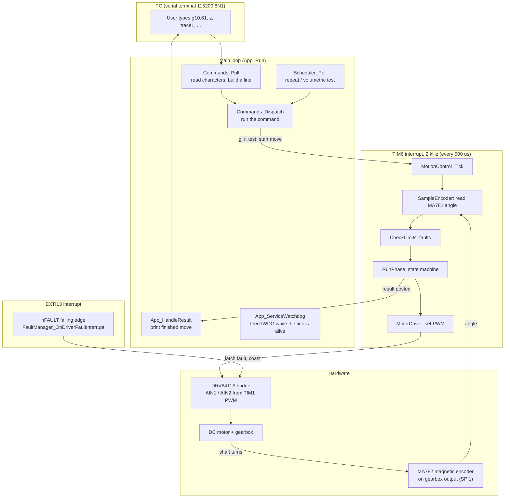

---

## 2. Power-up (App_Init)

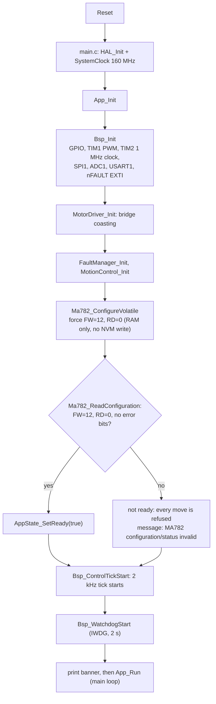

---

## 3. Main loop (App_Run)

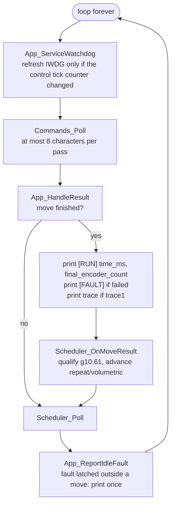

---

## 4. Serial command handling

A command line ends with newline. The letter `x` is special: it is acted on immediately, even in the middle of a move.

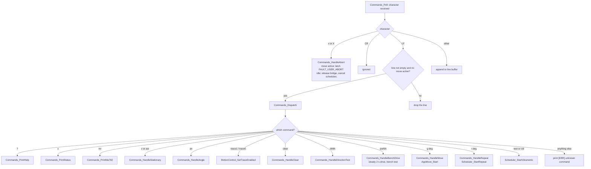

---

## 5. Starting a move (AppMove_Start)

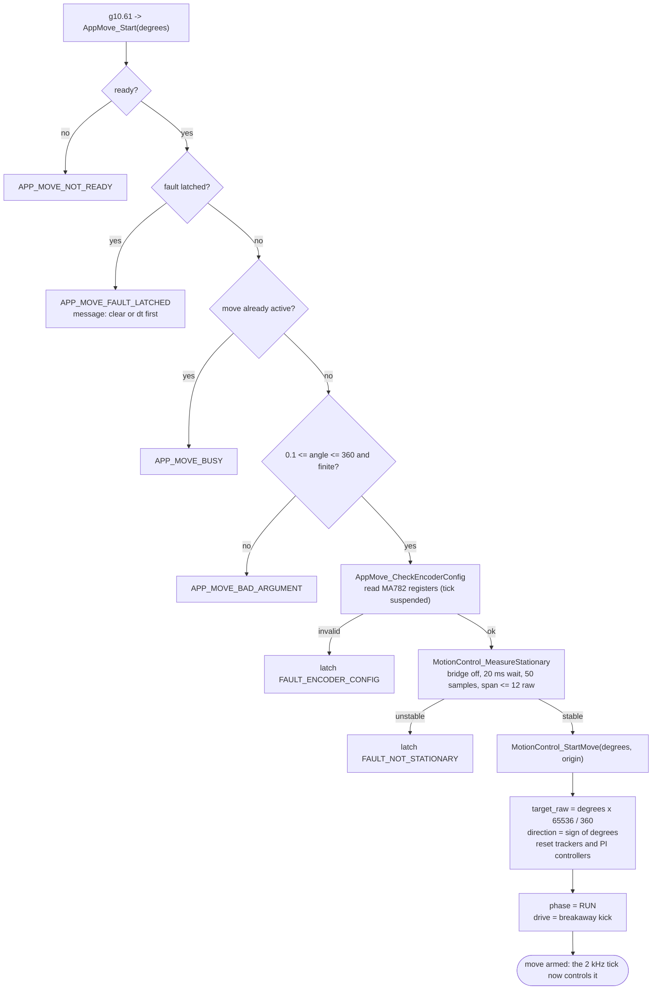

Each move is **relative** to a freshly measured stationary start angle, not to an absolute position.

---

## 6. One control tick (MotionControl_Tick, every 500 us)

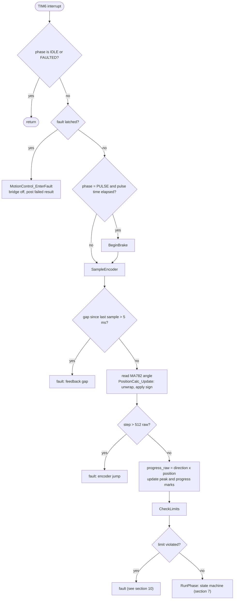

---

## 7. Move state machine

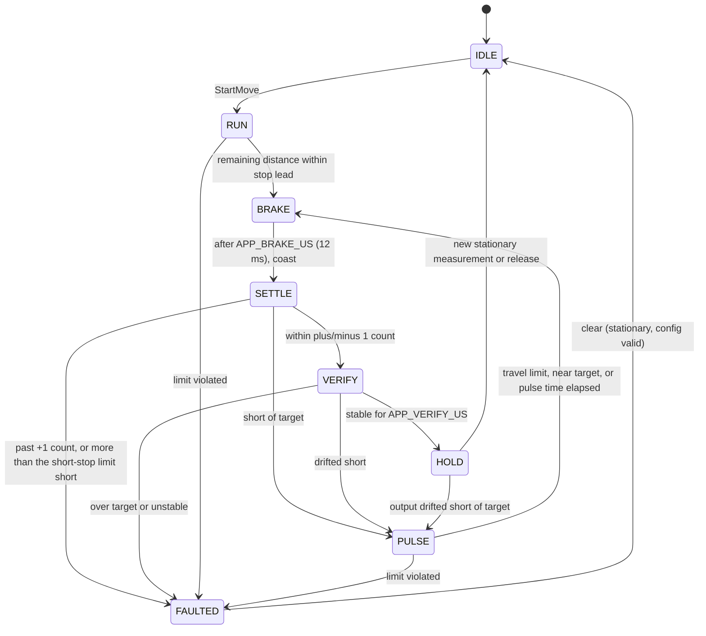

Phase meaning:

| Phase | What the motor is doing | Ends when |
|---|---|---|
| RUN | speed loop drives toward the target | remaining distance <= brake lead |
| BRAKE | both bridge inputs high (motor shorted) for 12 ms | timer |
| SETTLE | bridge off (coast) for 20 ms so the shaft stops | timer, then decision |
| PULSE | short forward pulse to catch up (never reverse) | time, 20 raw travel, or near target |
| VERIFY | bridge off, shaft must stay within +/-1 count (span <= 12 raw) | window elapsed |
| HOLD | bridge off, move is complete and reported | next command |

---

## 8. RUN phase - the speed loop (every 8 ms)

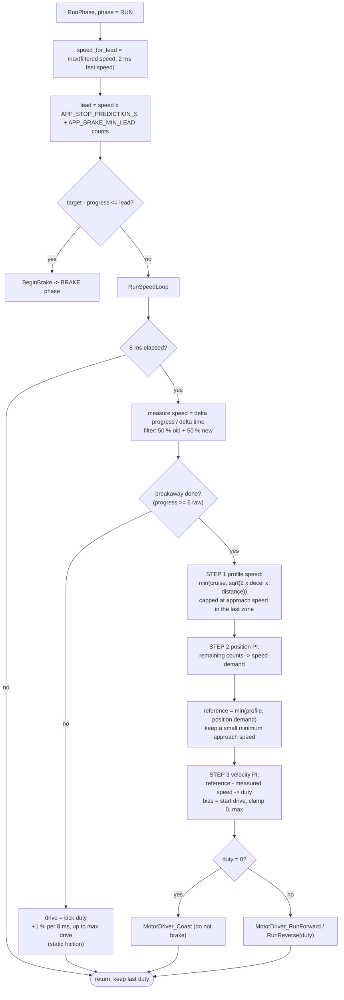

---

## 9. After the brake - settle decision and catch-up pulses

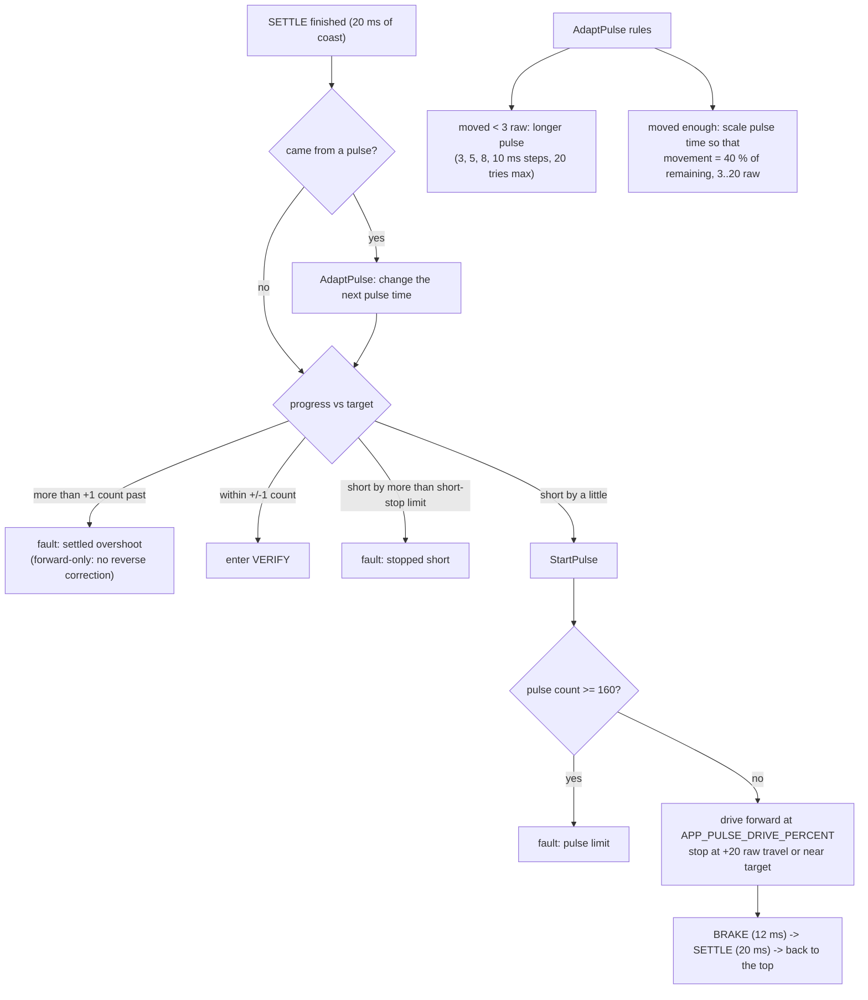

---

## 10. Faults

Only the **first** fault is kept. The response is always the same: **bridge coasts**, the move result is posted as failed,
and further moves are refused until `clear`.

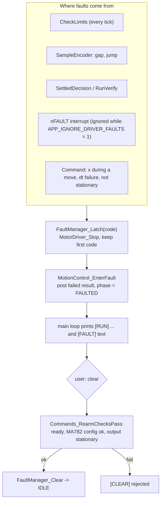

CheckLimits tests, in order:

| Check | Fault | Typical cause |
|---|---|---|
| IPROPI current > limit (skipped when faults ignored) | `FAULT_DRIVER_OVERCURRENT` | stall, wrong sense resistor |
| peak > target + 1 count | `FAULT_OVERTRAVEL` | stop too late / burst |
| peak - progress > reverse limit | `FAULT_ROLLBACK` | gear recoil bigger than the allowance |
| move time > 30 s | `FAULT_MOVE_TIMEOUT` | too slow |
| no 2-raw progress for 1.2 s | `FAULT_NO_PROGRESS_TIMEOUT` | stuck / no power / jam |

---

## 11. Motor driver - from duty to the two bridge inputs

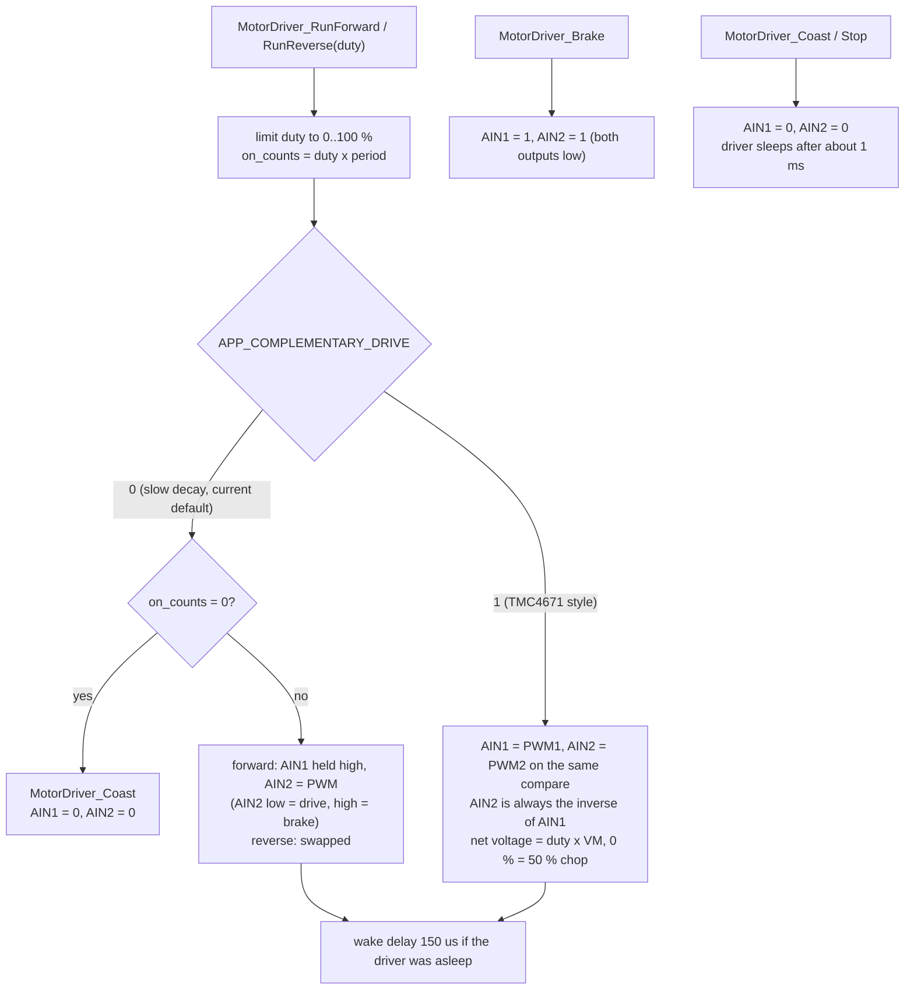

DRV8411A inputs: `00` coast, `10` forward, `01` reverse, `11` brake.

---

## 12. Stationary check and direction test

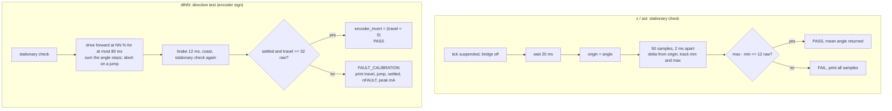

---

## 13. Volumetric and repeatability schedulers

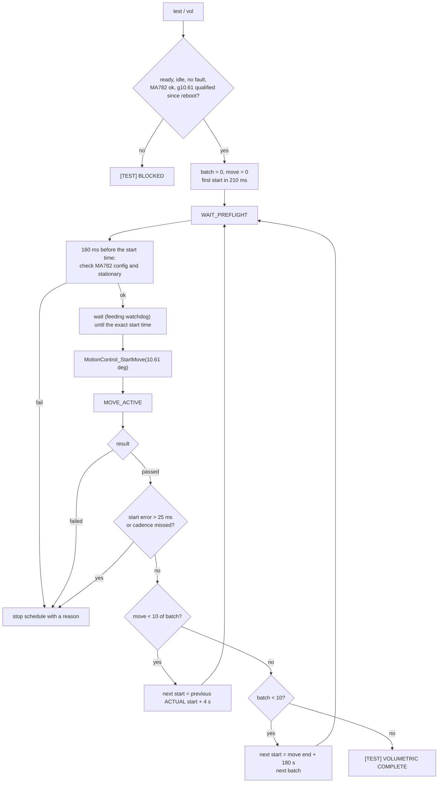

Repeatability (`r<deg>`): 10 moves, 4 s of rest after each completion, stops at the first fault.

---

## 14. NodeMCU + TMC4671 to STM32 - where each function went

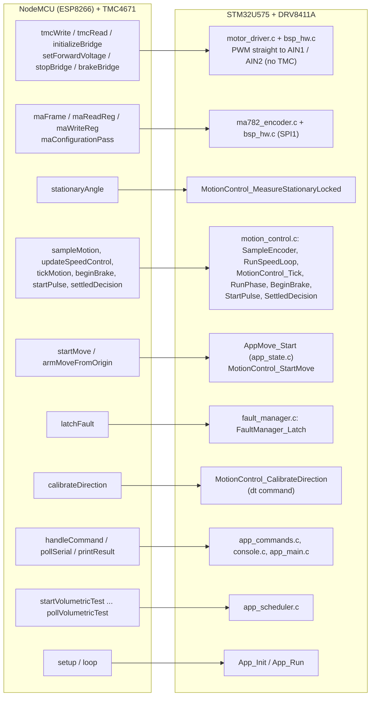

What the TMC4671 used to do: generate the PWM and apply a requested voltage (`UQ_UD_EXT`, open-loop voltage mode)
to the DRV8411A inputs. All control loops (speed PI, position logic, braking, pulses) were already software on the NodeMCU.
On the STM32 the PWM is generated by timer TIM1 directly and the TMC4671 is removed.
